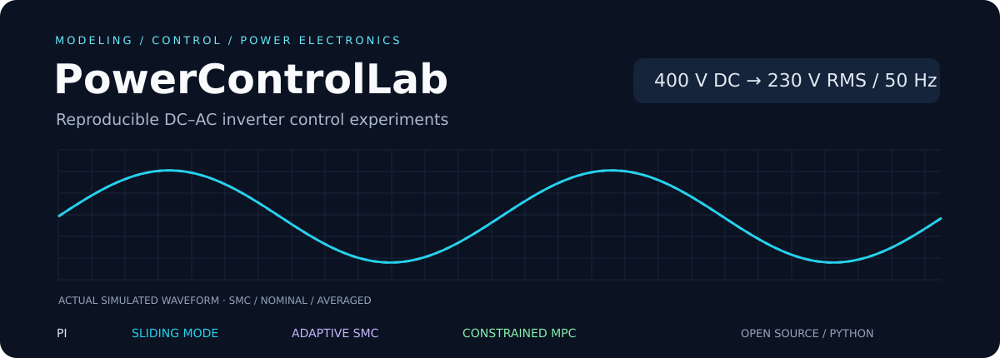
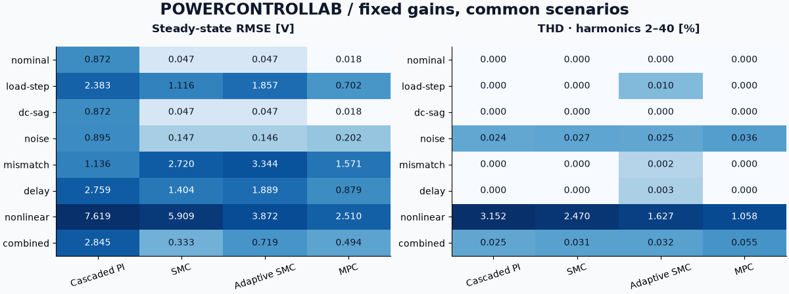
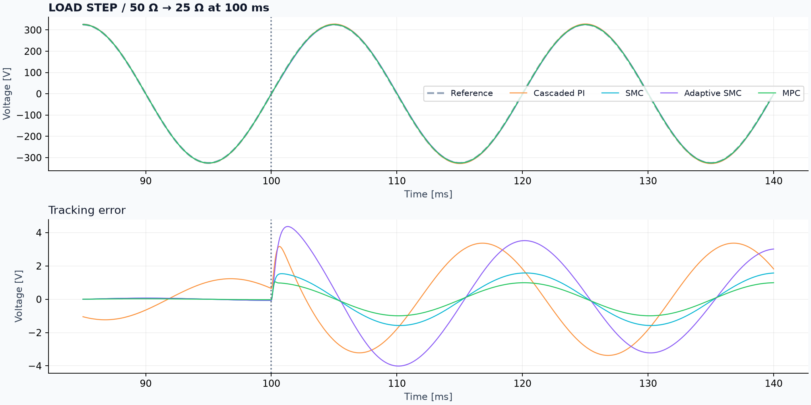
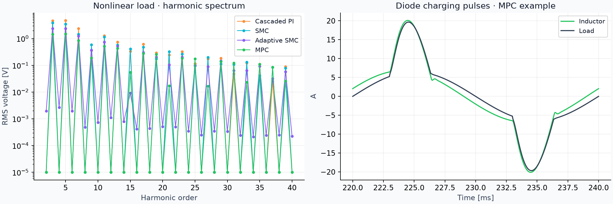
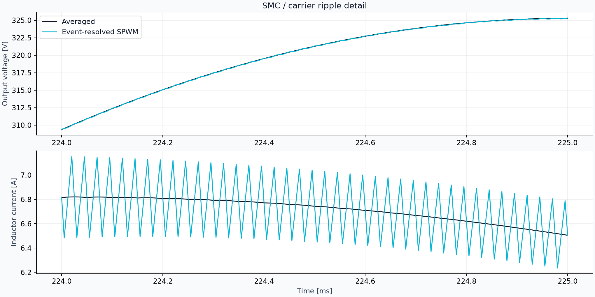
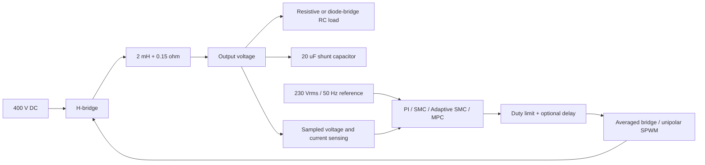

<p align="center">
  
</p>

<p align="center">
  <a href="https://github.com/mohammmad357/PowerControlLab/actions/workflows/ci.yml"></a>
  
  <a href="LICENSE"></a>
  
</p>

**A reproducible engineering benchmark for a 400 V DC → 230 Vrms, 50 Hz inverter.**
Model an LC-filtered H-bridge, apply electrical disturbances, and compare cascaded PI,
sliding-mode, adaptive sliding-mode and constrained model-predictive control using measured
simulation results.

[Quick start](#quick-start) · [Results](#measured-results) · [Model](docs/model.md) ·
[Controller derivations](docs/controllers.md) · [Protocol](docs/benchmark.md) ·
[فارسی](docs/README_FA.md)

## What you can investigate

- **Two plant fidelities:** a fast averaged inverter and event-resolved unipolar SPWM.
- **Four controllers:** cascaded PI, boundary-layer SMC, adaptive-gain SMC and
  a 16-step constrained QP MPC using OSQP.
- **Eight scenarios:** load step, DC sag, sensor noise, L/C mismatch, actuator delay,
  dynamic diode-bridge load, combined disturbances and nominal operation.
- **Transparent metrics:** coherent THD, tracking RMSE, fundamental/RMS voltage,
  cycle-based recovery, saturation, peak current and solver diagnostics.
- **Reproducible experiments:** seeded noise, configurations, raw waveforms,
  dependency versions and a hash of the simulation source.
- **Extensible software:** installable package, CLI, Streamlit explorer, notebook,
  independent numerical checks and cross-platform CI.

This is a **simulation-based digital-twin foundation**. Physical hardware calibration and
validation are future work. See the [model scope](docs/model.md#digital-twin-scope) before
interpreting the results as evidence about a physical inverter.

## Quick start

Requires Python 3.11 or newer.

```bash
git clone https://github.com/mohammmad357/PowerControlLab.git
cd PowerControlLab
python -m venv .venv
```

Activate the environment using the command for your shell:

| Shell | Activation command |
|---|---|
| Windows PowerShell | `.\.venv\Scripts\Activate.ps1` |
| Windows CMD | `.venv\Scripts\activate.bat` |
| macOS/Linux | `source .venv/bin/activate` |

If PowerShell blocks activation scripts, you can use the environment's Python directly,
without changing the execution policy:

```powershell
.\.venv\Scripts\python.exe -m pip install -e ".[dev,dashboard]"
.\.venv\Scripts\python.exe main.py --controller smc --load nonlinear
```

Otherwise, after activation:

```bash
python -m pip install -e ".[dev,dashboard]"
python main.py --controller smc --load nonlinear
```

The command prints computed metrics and writes `metrics.json`, `run.json`,
`waveforms.npz`, `traces.png` and a benchmark CSV under `results/`.

```bash
# Compare four controllers on the load step
powercontrollab --controller all --scenario load-step

# Run the full 32-case averaged benchmark
powercontrollab --controller all --scenario all

# Resolve switching ripple with exact PWM transition times
powercontrollab --controller smc --mode switching

# Change nominal engineering parameters (SI units)
powercontrollab --controller mpc --inductance 0.0025 --capacitance 0.000025

# Explore experiments in a local dashboard
streamlit run dashboard/app.py
```

Use a fresh `--output` directory to preserve different experiments; rerunning the
same output path replaces that run's artifacts. `--no-plots` and `--no-raw` produce compact
metric-only experiments. Run `powercontrollab --help` for all options.

## Measured results

These numbers are generated by `python scripts/reproduce.py`, using fixed gains,
400 V DC, 230 Vrms/50 Hz, 20 kHz control, a 5 µs integration step and seed 7.
The table uses the **averaged plant** and the final five complete cycles, `[140,240) ms`.
THD includes orders 2–40. Switching ripple is evaluated separately.

<!-- BENCHMARK:START -->
| Scenario | Controller | THD₂–₄₀ [%] | Steady RMSE [V] | Recovery [ms] |
|---|---|---:|---:|---:|
| nominal | Cascaded PI | 0.000 | 0.872 | 20.00 |
| nominal | SMC | 0.000 | 0.047 | 20.00 |
| nominal | Adaptive SMC | 0.000 | 0.047 | 20.00 |
| nominal | MPC | 0.000 | 0.018 | 20.00 |
| nonlinear | Cascaded PI | 3.152 | 7.619 | not settled |
| nonlinear | SMC | 2.470 | 5.909 | not settled |
| nonlinear | Adaptive SMC | 1.627 | 3.872 | 20.00 |
| nonlinear | MPC | 1.058 | 2.510 | 20.00 |
<!-- BENCHMARK:END -->

Recovery means one-cycle RMS tracking error stays within 2% of requested RMS voltage
through the end of the run. Its origin is the event or the end of startup; the minimum
measurable value is one cycle (20 ms). “Not settled” is an explicit outcome.
No controller ordering is hard-coded. These tunings and experiments do not establish
universal superiority. See the [complete protocol](docs/benchmark.md).



[All 40 averaged/switching results](artifacts/reference/RESULTS.md) ·
[Averaged CSV](artifacts/reference/benchmark.csv) ·
[Switching CSV](artifacts/reference/switching/benchmark.csv) ·
[Numerical convergence](artifacts/reference/convergence.json)

<details>
<summary><strong>Load step, nonlinear load and switching detail</strong></summary>







</details>

## The engineering model



The states follow

$$L\frac{di_L}{dt}=u_{bridge}-v_o-r_Li_L,\qquad
C\frac{dv_o}{dt}=i_L-i_{load}.$$

The nonlinear load adds a third state for a diode-bridge DC capacitor. Splitting at
switching edges prevents duty quantization on the integration grid. Controllers receive
the same observations; mismatch scenarios retain nominal controller parameters.

Read the [plant equations](docs/model.md) and [controller laws with gain units](docs/controllers.md)
for the assumptions behind every result. The topology is consistent with voltage-source
LC inverter practice described by [Texas Instruments](https://www.ti.com/tool/TIDM-HV-1PH-DCAC);
this project uses independently chosen parameters and controller implementations.

## Python API

```python
from powercontrollab import PlantConfig, SimulationConfig, simulate
from powercontrollab.analysis import compute_metrics

plant = PlantConfig(inductance=2e-3, capacitance=20e-6)
experiment = SimulationConfig(scenario="dc-sag", seed=7)
result = simulate("mpc", plant=plant, config=experiment)
print(compute_metrics(result))
# result.time, result.voltage, result.current, result.modulation, ...
```

The [demo notebook](notebooks/demo.ipynb) covers a nominal comparison, a disturbed run and
harmonic analysis. Install `python -m pip install -e ".[notebook]"` to use it locally.

## Verification and reproducibility

```bash
python -m pytest
python -m ruff check .
python -m ruff format --check .
python scripts/reproduce.py
python scripts/validate_numerics.py
```

Tests check energy balance, RK4 against a matrix exponential, exact PWM averages,
known-harmonic THD, MPC against an independent optimizer, anti-windup, solver failure,
deterministic noise, actuator delay, convergence, CLI exports and the dashboard.
CI also builds the Python distribution.

For the Python 3.13 reference numerical dependency versions, install
`python -m pip install -r requirements-repro.txt` after the project. Each run records a
source hash and library versions in `run.json`. CPU timings depend on the machine.

## Repository guide

```text
src/powercontrollab/
  models/          H-bridge, LC state space and loads
  controllers/     PI, SMC, adaptive SMC, constrained MPC
  modulation/      Unipolar SPWM with exact edge times
  analysis/        Coherent FFT, THD and tracking metrics
  simulation.py    Sampled-data simulation and disturbances
  cli.py           Single runs and benchmark matrices
dashboard/         Optional Streamlit explorer
notebooks/         Worked engineering demo
scripts/           Reproduction and refinement studies
artifacts/         Computed reference metrics and figures
docs/              Equations, control laws and protocol
tests/             Physics, numerical and integration checks
```

## Extend the lab

See [CONTRIBUTING.md](CONTRIBUTING.md) for extension contracts.
[Research directions](docs/roadmap.md) include parameter identification, current-constrained
MPC, delay compensation and hardware validation. Report issues with the command, configuration
and seed. Released under [MIT](LICENSE); cite the version and commit using [CITATION.cff](CITATION.cff).

